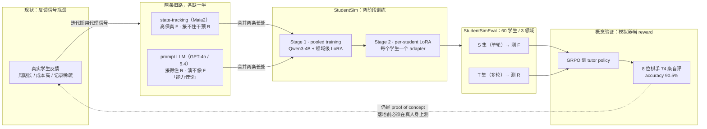

# StudentSim：让 AI 教师在真实学生研究前获得可度量反馈 · 精读版

> 视频：StudentSim：让AI教师在真实学生研究前获得可度量反馈（NICE学术 · 第 209 期）
> BV：BV1EMJQ6tE8d　|　时长：63 分 15 秒　|　讲者：杨可（UIUC 四年级博士生）　|　主持人：钱程（UIUC 三年级博士生）
> 论文：*StudentSim: Training LLM-based Student Simulators* — arXiv:2609.01591（2026-09-01）
> 代码：https://github.com/microsoft/StudentSim
> 完整转写：`../transcript.md`（21,562 字符）　|　口播 deck：`../deck/index.html`　|　PPTX：`../slides/output/`

---

## 一、一句话说清

AI 教师好不好，不看它的指导写得多漂亮，而看**学生收到之后产生了什么反应**。
但这份反馈要等真学生，短则几个月、长则几年 —— 于是这篇工作把「学生」换成了
**按每个学生单独训练的 LLM 模拟器**，先在虚拟学生身上把 AI 教师练到会教，
再用真人做最终验收。

## 二、八条结论（每条三行）

**1. 瓶颈不是模型，是「学生信号」**　`问题`

- 判断 AI 教师好不好，不看指导写得漂不漂亮，而看学生收到之后产生了什么反应。
- 但改一个小细节就要等几个月甚至几年才能拿到这份反馈 —— 早期迭代被卡死在数据上。

**2. 旧的两条路各占一半，都不够**　`框架`

- state-tracking（Maia2）后验地追踪学生状态，保真但接不住干预；prompt LLM 接得住指导，但「太有能力」。
- 后者叫「能力悖论」：让它演幼儿园学生做微积分，语言幼稚但解题步骤依然专业 —— 信号嘈杂。

**3. 把问题定义成 F × R 两个维度**　`框架`

- Behavioral Fidelity：模拟得像不像这个学生；Guidance Responsiveness：接不接得住老师的指导。
- 旧方法正好落在两个极值点上，目标是右上角 —— 两个都要高。

**4. 两阶段训练解决「每人一两条记录」**　`方法`

- 先 pooled training 学领域共性，再在 base adapter 上做 per-student LoRA 特化。
- 二语写作数据集采了整整一年，人均 3 篇、超 70% 的人不超过 5 篇 —— 直接训必然过拟合。

**5. 4B 小模型在两个维度上赢过 GPT-5.4**　`结果`

- 三个领域都是：Maia2 像但不听，GPT-5.4 听但不像，StudentSim 两头都要。
- 而且模拟器小、开放、可本地部署 —— reward 可以自己跑。

**6. 模拟器当 reward，专家盲评确实更好**　`结果`

- 8 位有段位的棋手、74 条盲评：StudentSim reward 的 accuracy 90.5%，guidance 3.31，personalization 3.93。
- 三个条件共享 tutor policy / SFT 起点 / GRPO 设置，差异只来自 reward。

**7. 反直觉：用 GPT-5.4 当 reward 反而更差**　`反直觉`

- GPT-5.4 reward 的 accuracy 只有 71.6%，比完全不训练 RL 的 75.7% 还低，personalization 2.42 最低。
- 因为它不懂「过往记录 → 应有表现」这一步 mapping，噪声信号把 policy 带偏了。

**8. 它能推广，但有三堵墙**　`边界`

- 方法论可迁移：symbolic → neural → training 三部曲，可用到任何 human simulator。
- 但长程追踪（遗忘、顿悟）、学生隐私、模拟群体的代表性（validity）都还没有答案。

## 三、结构图：从瓶颈到可度量的反馈

**怎么看这张图（三句）**

1. 整条链的起点是**信号瓶颈**，不是模型能力 —— 所以解法是「换一个更便宜、更多样的信号来源」。
2. 中间那个 **F × R 右上角**是全文的枢轴：旧方法各占一角，合起来才有 StudentSim。
3. 末端是 **proof of concept**：模拟器当 reward 确实让 AI 教师变好，但论文自己写明
   「这不是我们做出了最好的家教」，落地前仍要在真人身上验证。

## 四、关键数字（可逐条回查）

| 数字 | 含义 | 说明 |
|---|---|---|
| `0.51 / 0.91` | 棋类 F / R | StudentSim（Qwen3-4B + per-player LoRA） |
| `0.23 / 0.72` | 棋类 F / R | GPT-5.4（in-context 提示） |
| `0.45 / 0.27` | 棋类 F / R | Maia2（state-tracking，无语言输入通路） |
| `90.5%` | 人类盲评 Accuracy | StudentSim reward（最高） |
| `71.6%` | 人类盲评 Accuracy | GPT-5.4 reward —— 低于不训练 RL 的 75.7% |
| `60` | 受评学生数 | chess 30 / L2 写作 15 / math 15 |
| `74` | 盲评标注数 | 来自 8 位有段位的竞技棋手 |
| `4B` | 基座模型规模 | Qwen3-4B-Instruct |

> 棋类 F / R 三行均出自 arXiv:2609.01591 摘要与正文 Table 2 / Table 3；
> 盲评三行出自正文 Table 4（74 条标注 / 8 位标注者）。

## 五、怎么核对（每条结论都能回查）

| 结论 | 视频位置 | 转写锚点 |
|---|---|---|
| 瓶颈不是模型，是「学生信号」 | 00:00–10:00 | 「收集数据的 bottleneck」 |
| 旧的两条路各占一半，都不够 | 00:00–10:00 | state-tracking models / prompt LLM / 能力的悖论 |
| 把问题定义成 F × R 两个维度 | 10:00–20:00 | behavioral fidelity / guidance responsiveness |
| 两阶段训练解决「每人一两条记录」 | 10:00–20:00 | 「第一阶段 pooled training / 第二阶段 student-specific」 |
| 4B 小模型在两个维度上赢过 GPT-5.4 | 30:00–40:00 | 「我们是一个非常小的模型，train 的是一个 4 billion 的 model」 |
| 模拟器当 reward，专家盲评确实更好 | 40:00–50:00 | accuracy / guidance / personalization 三个维度 |
| 反直觉：用 GPT-5.4 当 reward 反而更差 | 40:00–50:00 | 「GPT-4 reward 反而让它的成绩指标下降了」 |
| 它能推广，但有三堵墙 | 40:00–60:00 | symbolic / neural / training 三部曲 + Q&A |

- **时间戳是分片边界**（每 10 分钟一片），不是词级时间戳 —— 语音识别输出不含词级时间信息，
  编造精确到秒的时间戳会给出假精度。
- 精确核对方式：在 `../transcript.md` 里搜上表「转写锚点」列的关键词。
- 论文侧核对方式：arXiv 摘要 → Table 2（F）→ Table 3（R）→ Table 4（人类盲评）→ §6（tutor RL）。

## 六、口径与边界

- **这是我的归纳，不是发言人原话**：第八条结论「它能推广，但有三堵墙」是本次整理的归纳，
  讲者分别在三部曲（方法）、Q&A（隐私 / 代表性）和结尾（开销）里说了这三点，但没这样归纳过。
- **paper 与 talk 的口径差异**：论文 Table 4 的列顺序是 Accuracy / Guidance / Personalization，
  对应 90.5 / 3.31 / 3.93。二手解读常把后两列写反，本页按论文原表。
- **未采用的数字**：网上流传的「2000+ Elo 子集 93.3% vs 56.7%」在本页引用的 arXiv HTML 全文中
  **未检索到**，因此不写进结论；论文只写明该子集与三重标注子集「给出相同排序」。
- **转写由语音识别生成**，人名与技术名词可能有同音错字，已按上下文校正（杨可 / 钱程 / Maia2）。
- **转录分片**：第 2 片（10:00–20:00）首次被上游语音识别服务拦截，已通过切成 4 段重试补回，
  内容完整。
- **论文自陈的边界**：chess 是 proof of concept；迁移到自由文本领域需要各自的 reward 函数，
  这不在论文验证过的范围内。

> 免责声明：本输出由 AI 辅助生成，仅用于信息整理与研究参考，不构成专业意见或决策依据。
